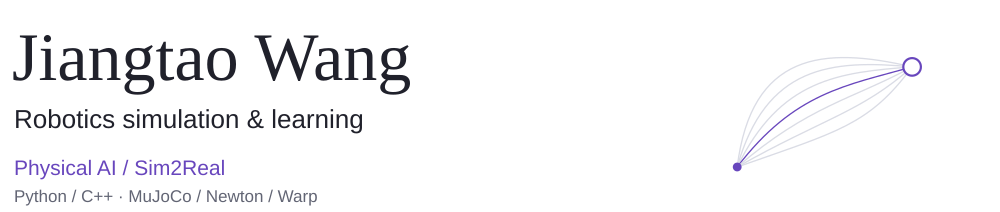
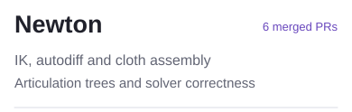
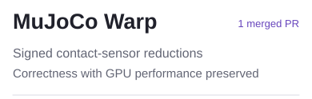
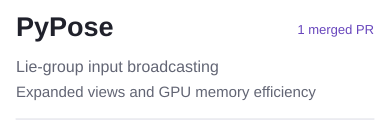
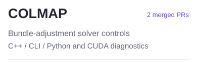
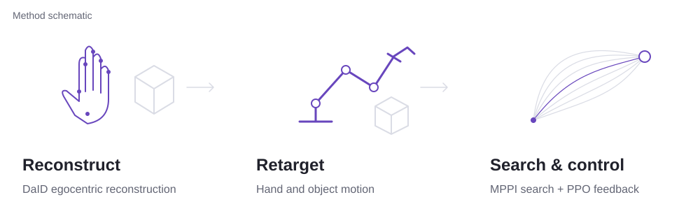
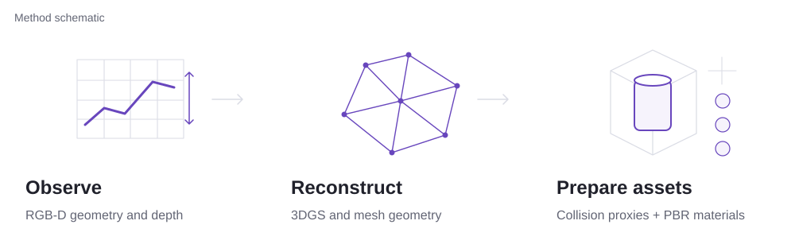
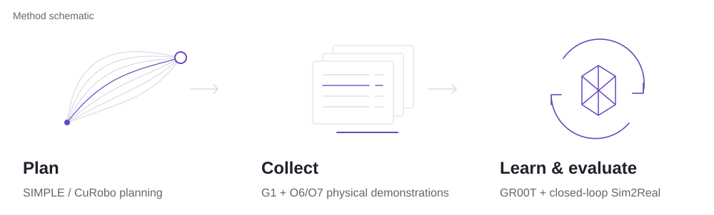

<picture>
  <source media="(max-width: 600px) and (prefers-color-scheme: dark)" srcset="assets/banner-mobile-dark.svg">
  <source media="(max-width: 600px)" srcset="assets/banner-mobile-light.svg">
  <source media="(prefers-color-scheme: dark)" srcset="assets/banner-dark.svg">
  
</picture>

I build simulation pipelines for robot learning and manipulation, with open-source work on numerical correctness and GPU memory efficiency.

[Engineering Notes](https://cola1917-github-io-six.vercel.app/en/) · [GitHub](https://github.com/cola1917) · [Contribution Ledger](CONTRIBUTIONS.md)

## Open Source Contributions

<!-- BEGIN AUTO:SELECTED_CONTRIBUTIONS -->
**10 merged upstream PRs** across Newton, MuJoCo Warp, PyPose, and COLMAP.

<a href="https://github.com/pulls?q=is%3Apr%20is%3Amerged%20author%3Acola1917%20repo%3Anewton-physics/newton">
<picture>
  <source media="(prefers-color-scheme: dark)" srcset="assets/contribution-newton-dark.svg">
  
</picture>
</a>
<a href="https://github.com/pulls?q=is%3Apr%20is%3Amerged%20author%3Acola1917%20repo%3Agoogle-deepmind/mujoco_warp">
<picture>
  <source media="(prefers-color-scheme: dark)" srcset="assets/contribution-mujoco-warp-dark.svg">
  
</picture>
</a>

<a href="https://github.com/pulls?q=is%3Apr%20is%3Amerged%20author%3Acola1917%20repo%3Apypose/pypose">
<picture>
  <source media="(prefers-color-scheme: dark)" srcset="assets/contribution-pypose-dark.svg">
  
</picture>
</a>
<a href="https://github.com/pulls?q=is%3Apr%20is%3Amerged%20author%3Acola1917%20repo%3Acolmap/colmap">
<picture>
  <source media="(prefers-color-scheme: dark)" srcset="assets/contribution-colmap-dark.svg">
  
</picture>
</a>

**Selected PR evidence**

- **Newton:** [IK correctness #4871](https://github.com/newton-physics/newton/pull/4871) · [Autodiff L-BFGS #4874](https://github.com/newton-physics/newton/pull/4874) · [Cloth assembly #4942](https://github.com/newton-physics/newton/pull/4942)
- **MuJoCo Warp:** [Contact reductions #1853](https://github.com/google-deepmind/mujoco_warp/pull/1853)
- **PyPose:** [Broadcast views #439](https://github.com/pypose/pypose/pull/439)
- **COLMAP:** [BA controls #4892](https://github.com/colmap/colmap/pull/4892) · [Driver diagnostics #4903](https://github.com/colmap/colmap/pull/4903)

[View All Merged PRs](https://github.com/pulls?q=is%3Apr+is%3Amerged+author%3Acola1917) · [Verified contribution ledger](CONTRIBUTIONS.md)

*Upstream merges only above; personal repositories and fork merges are listed separately in the ledger.*
<!-- END AUTO:SELECTED_CONTRIBUTIONS -->

## Selected Engineering Projects

*Project descriptions and metrics below are self-reported and have not been independently verified against public code or experiment records. Illustrations are method schematics.*

### Ego Demonstration Retargeting

Reconstruct egocentric dexterous manipulation and retarget hand–object motion using DaID, MPPI physical search, and PPO feedback control.

<picture>
  <source media="(max-width: 600px) and (prefers-color-scheme: dark)" srcset="assets/project-retargeting-mobile-dark.svg">
  <source media="(max-width: 600px)" srcset="assets/project-retargeting-mobile-light.svg">
  <source media="(prefers-color-scheme: dark)" srcset="assets/project-retargeting-dark.svg">
  
</picture>

| Reported result | Evaluation scope |
| :--- | :--- |
| **4.41× faster** · 1,564 → 354 s | Reference construction for 276 frames |
| **34.4% → 73.4%** basket success | Fixed development set |

### 3D Reconstruction & Simulation Assets

Recover scene geometry and materials with RGB-D, 3DGS, meshes, differentiable rendering, and PBR.

<picture>
  <source media="(max-width: 600px) and (prefers-color-scheme: dark)" srcset="assets/project-reconstruction-mobile-dark.svg">
  <source media="(max-width: 600px)" srcset="assets/project-reconstruction-mobile-light.svg">
  <source media="(prefers-color-scheme: dark)" srcset="assets/project-reconstruction-dark.svg">
  
</picture>

**Engineering scope:** metric dimensions, collision-proxy repair, and Lambert + GGX material optimization.

### Simulation Data Generation & Sim2Real

Build planning and physical demonstration pipelines with SIMPLE, CuRobo, and G1 + O6/O7; fine-tune GR00T and evaluate closed-loop behavior.

<picture>
  <source media="(max-width: 600px) and (prefers-color-scheme: dark)" srcset="assets/project-sim2real-mobile-dark.svg">
  <source media="(max-width: 600px)" srcset="assets/project-sim2real-mobile-light.svg">
  <source media="(prefers-color-scheme: dark)" srcset="assets/project-sim2real-dark.svg">
  
</picture>

| Reported result | Evaluation scope |
| :--- | :--- |
| **1,000 successful trajectories** | Physical manipulation demonstrations |
| **86.7% simulation / 60% real-robot success** | No real-robot training data |

## Technical Stack

- **Robotics:** Robot kinematics · collision detection · MPPI · CuRobo
- **Physics:** MuJoCo · Newton · NVIDIA Warp
- **Learning:** PPO · GR00T · VLA · Sim2Real
- **Graphics:** RGB-D · 3DGS · differentiable rendering · PBR
- **Engineering:** Python · C++ · Git · regression testing

## Links

[GitHub](https://github.com/cola1917) · [Engineering Notes](https://cola1917-github-io-six.vercel.app/en/)
